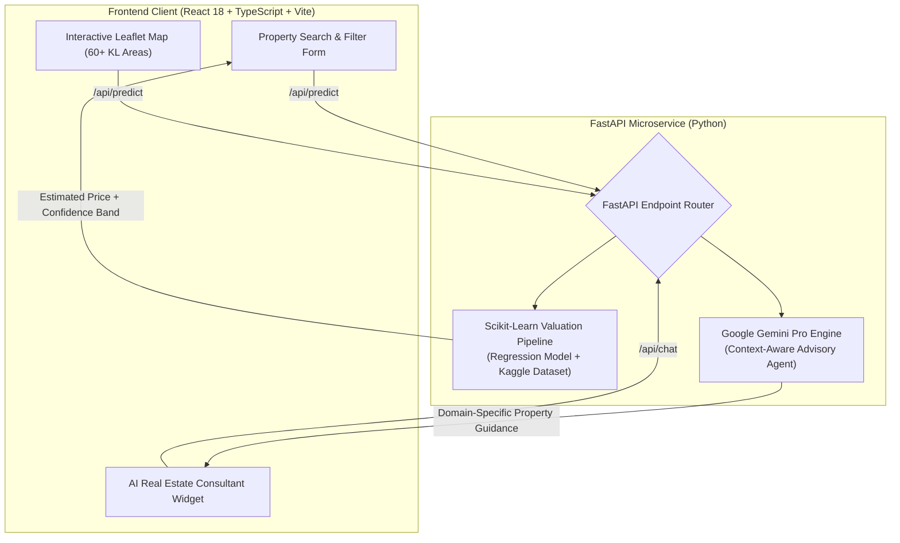

# 🏙️ UrbanVal: AI-Powered Real Estate Valuation & Advisory Platform

[](https://react.dev/)
[](https://www.typescriptlang.org/)
[](https://fastapi.tiangolo.com/)
[](https://tailwindcss.com/)
[](https://ai.google.dev/)
[](https://scikit-learn.org/)
[](LICENSE)

An end-to-end, full-stack real estate intelligence application that delivers **machine-learning price predictions**, **geospatial property visualization**, and an **interactive generative AI property advisor** for the Kuala Lumpur metropolitan property market.

---

## 🏗️ System Architecture



---

## 🌟 Core Features

### 1. ML Property Valuation Engine (`/api/predict`)
* Trained on comprehensive real estate transactions covering **60+ localities across Kuala Lumpur**.
* Ingests structural parameters: location, square footage, room count, bathroom count, parking slots, and furnishing grade (`unfurnished`, `partially furnished`, `fully furnished`).
* Outputs high-precision market valuation estimates with confidence intervals.

### 2. Conversational Real Estate Advisor (`/api/chat`)
* Powered by Google's **Gemini Pro** API.
* Injected with tailored system instructions constraining the agent to factual property guidance, buyer/investor consulting, and intelligent handoffs to the numerical valuation tool.

### 3. Interactive Geospatial Exploration
* Integrated with **Leaflet** and **React-Leaflet** for interactive map browsing across metropolitan districts.
* Real-time spatial visualizer reflecting estimated regional square-footage pricing.

### 4. Modern Full-Stack Developer Experience
* **Concurrent Execution:** Built with `concurrently` enabling one-command launching (`npm run dev:all`) of both the Vite client and the Uvicorn FastAPI server.
* **Strict Type Safety:** End-to-end TypeScript interfaces matching Pydantic request/response schemas.

---

## 📂 Project Structure

```text
.
├── api/                    # Python FastAPI Backend
│   ├── main.py             # Application entrypoint & CORS middleware
│   ├── chat.py             # Google Gemini Pro conversational integration
│   ├── predict.py          # Machine learning model inference handler
│   └── recommendations.py  # Property matching & similarity engine
├── src/                    # Frontend React Client
│   ├── components/         # Map, Valuation Form, Chatbot & Result Cards
│   ├── model/              # Python ML training pipeline (train.py)
│   └── App.tsx             # Root application orchestrator
├── data_kaggle.csv         # Real estate dataset
├── package.json            # Node dependencies & concurrent dev scripts
├── requirements.txt        # Python backend dependencies
├── .env.example            # Environment variables template
└── vite.config.ts          # Vite frontend build configuration
```

---

## 🚀 Quickstart Guide

### 1. Prerequisites
- **Node.js 18+** & **npm**
- **Python 3.10+**
- **Google Gemini API Key** ([Get free key here](https://aistudio.google.com/))

### 2. Clone & Configure
```bash
git clone https://github.com/hongjarren/CPT316ASSIGNMENT2.git
cd CPT316ASSIGNMENT2

# Copy environment template
cp .env.example .env
```
Add your Gemini API key in `.env`:
```ini
GEMINI_API_KEY=your_gemini_api_key_here
```

### 3. Install Dependencies
```bash
# Install frontend packages
npm install

# Install backend Python requirements
pip install -r requirements.txt
```

### 4. Run Full Stack Concurrently
Launch both Vite (`http://localhost:5173`) and FastAPI (`http://localhost:8000`) simultaneously:
```bash
npm run dev:all
```

---

## 🔒 Security Best Practices
* **No Plaintext API Keys**: Sensitive credentials are read at runtime via `python-dotenv` and guarded by `.gitignore`.
* **CORS Whitelisting**: Strict origin restrictions on the FastAPI server to prevent unauthorized cross-origin requests.

---

## 📜 License
MIT License. Open for educational, academic, and portfolio usage.
